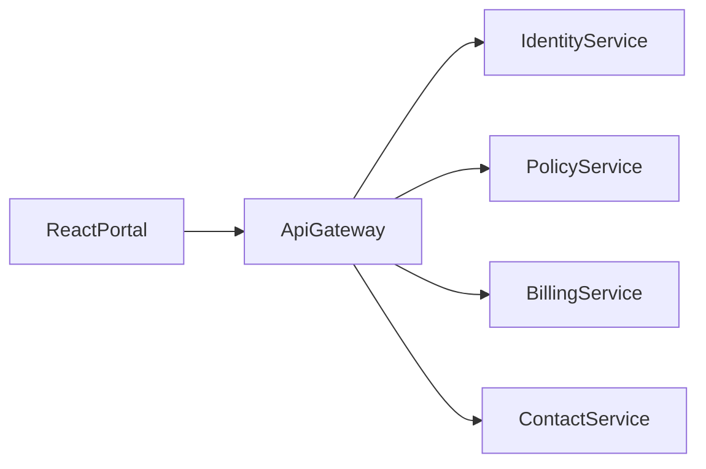

# Architecture

The browser talks only to the API gateway on port 8000. Vite proxies `/api` to that port during development.

## Services

- Identity, port 8001: register, login, current profile. Passwords are Argon2 hashes. Login returns an HMAC JWT that expires in one hour.
- Policy, port 8002: policies, documents, ID cards, renewal quotes, vehicles, drivers, and claims. Numbers must match `AUTO-XXXX` or `HOME-XXXX`. Vehicles and drivers are rejected on `HOME-` policies.
- Billing, port 8003: payment history and pay-pending. `InMemoryPaymentGateway` records the attempt and returns a fake confirmation id.
- Contact, port 8004: messages and calls. `InMemoryTwilio` records the attempt and returns a fake SID. It does not open a socket.
- Gateway, port 8000: `auth/login` and `auth/register` are public. Every other `/api` route requires a bearer token. The token is verified and then forwarded.

Each service keeps its own SQLite file under `services/<service>/data/`. Those files are gitignored. Startup seed inserts the demo customer and the three policies when the database is empty. That seed lives in the adapter, not in a use case.

## Boundaries

`domain/` may import the standard library, Pydantic, its ports, and `portal_common.identity`. SQL, JWT, Argon2, httpx, and FastAPI stay in adapters. `main.py` is the only composition root and the only place that reads environment variables.

`AuthContext` is the first argument of every repository method that reads or writes a customer's rows. The query filters on `user_id`. Identity `find_by_email` and `add` run before a token exists.

Money is `Decimal` in Python and a two-decimal string in JSON.

## Demo data

- Customer `demo.customer@example.com` / `Demo1234!`, user id `11111111-1111-1111-1111-111111111111`
- `AUTO-1001` Personal Auto, `AUTO-2044` Commercial Truck, `HOME-3008` Homeowners
- Each policy has documents. Auto policies have a vehicle and a driver. Payments mix paid and pending rows.

## Main routes

- `POST /api/auth/register`, `POST /api/auth/login`, `GET /api/auth/me`
- `GET /api/policies`, `GET /api/policies/{policy_number}`
- `POST /api/policies/{policy_number}/renew`, `GET /api/policies/{policy_number}/renewal`
- `GET /api/policies/{policy_number}/id-card`
- `GET /api/policies/{policy_number}/documents`, `GET /api/documents/{document_id}`
- `GET|POST /api/policies/{policy_number}/vehicles`, `DELETE .../vehicles/{vehicle_id}`
- `GET|POST /api/policies/{policy_number}/drivers`, `DELETE .../drivers/{driver_id}`
- `GET|POST /api/policies/{policy_number}/claims`
- `GET /api/payments`, `POST /api/payments/{payment_id}/pay`
- `GET|POST /api/contact/messages`, `GET|POST /api/contact/calls`
